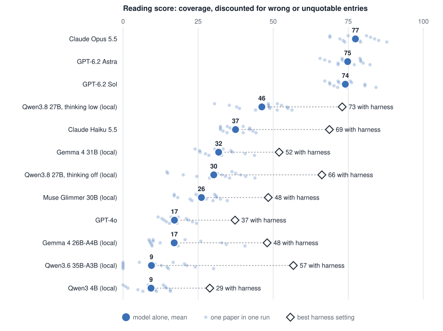
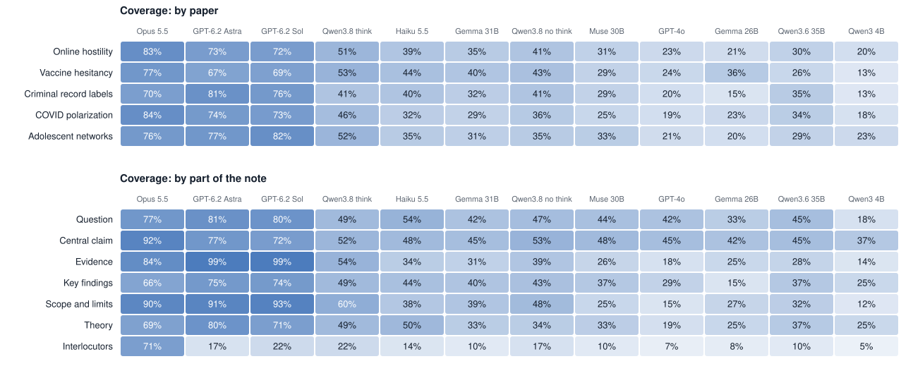
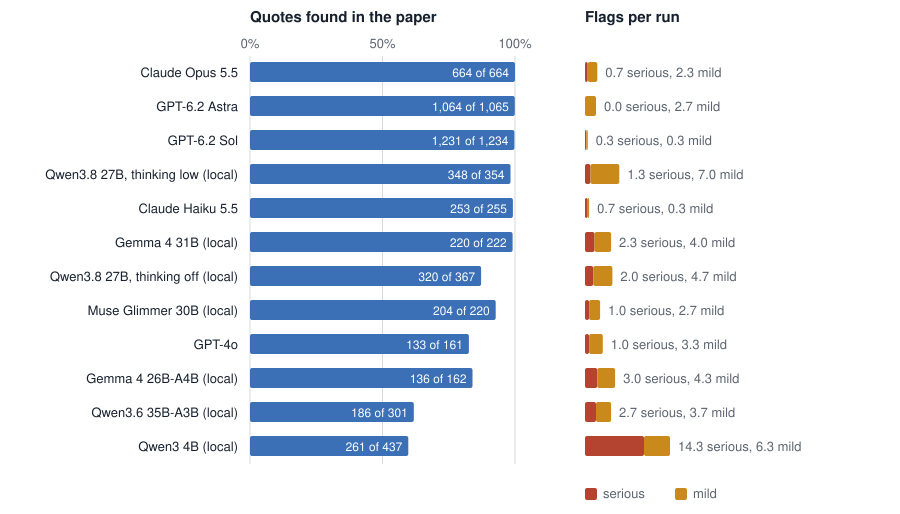
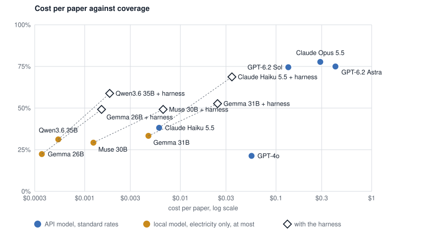
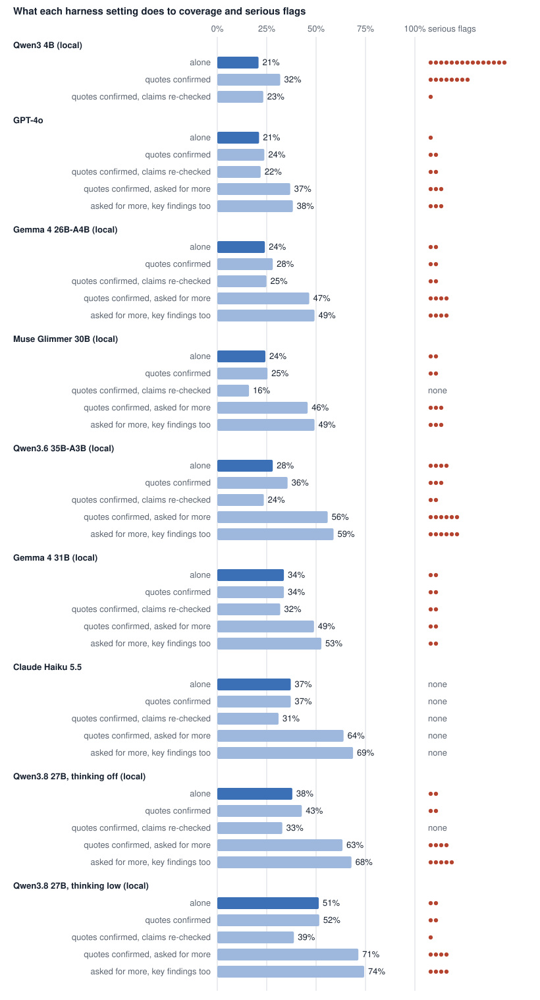

# Expert Reading Bench

*Grounded reading notes, scored against peer review.*

I built this as part of a longer effort to make myself a reliable reading assistant and interlocutor for research. Frontier models have become very good readers. I wanted to know where they still fall short, and what it takes to make smaller models dependable at the same job.

## The task

A model reads a research paper and writes a structured note with seven parts: the question, the central claim, the evidence, the key findings, the limits, the theory, and the earlier work the paper argues with. Every claim must carry a word-for-word quote from the paper and the number of the page it is on.

## The answers

Notes are scored against answers drawn from each paper's published peer review: what reviewers said the paper shows, and what they told the authors it does not. A reviewer restating a finding is evidence that the finding is central. A reviewer objecting to a claim, and the authors withdrawing it, marks a claim a careful reader should not repeat.

I used the review chain as an interpretable chain of evidence from which we could draw good answers and get a deeper understanding of the paper.

The set is five open-access papers from PLOS ONE with their full review histories, 187 accepted answers and 47 rejected ones. A human labeler reviewed and corrected every answer.

## What is measured

| Score | What it asks | Who checks |
|---|---|---|
| Quote fidelity | Is each quote in the paper, word for word? | Code |
| Page accuracy | Is it on the page the note says? | Code |
| Coverage | How many of the accepted answers does the note state, with a real quote behind them? | Judge |
| Core findings | Does it state the results that at least two reviewers restated? | Judge |
| Flags | Does it say more than the paper does? Serious: a wrong direction, an invented claim or quote, a wrong attribution. Mild: a small overstatement. | Judge |
| Critical reading bonus | Does it point out a place where the paper contradicts itself? | Judge |
| Reading score | Coverage, discounted by the share of a note's entries that are wrong or unquotable | Computed |

The reading score is coverage multiplied by the share of a note's entries that carry no serious flag and rest on a quote that is really in the paper. A model that finds many answers and also invents quotes scores lower than its coverage alone.

The judge is an LLM (Claude Opus 5.5 agents) working from written rules, the gold answers and the paper. On a blind sample of 60 answers weighted toward hard cases, it gave the same label as the human labeler on 52 (87%, Cohen's kappa 0.79). Where the two differed, the judge was usually the stricter.

The results also cover a harness: code around the model that checks and extends a note, and never sees the gold answers. It grew in three steps, each from a failure the benchmark exposed: first rejecting any claim whose quote is not in the paper, then having the model re-check its own claims, then asking it for more, part by part. What is good about it is that each setting targets one way of falling short, and the right one takes Claude Haiku 5.5 from 37% to 69% coverage for about three cents a paper, with no serious flags. It could still use improvement: its results are single runs, claim re-checking removes correct claims from an accurate model, and two further ideas were tested and dropped. The settings and the full table are in [The harness](#the-harness).

## Results



Each large point is a model's mean over its runs. The small points are single papers in single runs, so the spread of a row shows how much a model varies from paper to paper. The diamond is the same model with its best harness setting.

Here are the results for all the models I tested. I will add more soon.

| Model | Runs | Reading score | Coverage | Range over runs | Core findings (of 14) | Quotes in the paper | Serious flags per run | Cost per paper |
|---|---|---|---|---|---|---|---|---|
| Claude Opus 5.5 | 3 | 77 | 78% | 76 to 79 | 12.7 | 664 of 664 | 0.7 | $0.29 |
| GPT-6.2 Astra | 3 | 75 | 75% | 73 to 76 | 13.8 | 1,064 of 1,065 | 0 | $0.42 |
| GPT-6.2 Sol | 3 | 74 | 75% | 72 to 76 | 13.8 | 1,231 of 1,234 | 0.3 | $0.14 |
| Claude Haiku 5.5 | 3 | 37 | 38% | 37 to 40 | 10.2 | 253 of 255 | 0.7 | $0.006 |
| GPT-4o | 3 | 17 | 21% | 21 to 22 | 8.0 | 133 of 161 | 1 | $0.06 |
| Qwen3 4B (local, 4-bit) | 3 | 9 | 17% | 9 to 23 | 6.2 | 261 of 437 | 14.3 | 4.4 minutes on a laptop |

GPT-4o and the small local model are four points apart on coverage. The reading score separates them further, because the local model's notes carry far more wrong and unquotable entries.

The local model is also the only unstable one. Its runs are sampled, and in four of its fifteen notes it repeated one sentence pattern dozens of times in a single part and never reached the rest. That is why its range is 14 points where every other model's is 4 or less.

### Coverage by paper and by part of the note



The strong models are even across papers. The parts of the note tell them apart: the GPT-6.2 models are nearly complete on evidence and limits and name few of the earlier works a paper argues with, where Claude Opus 5.5 names most of them.

### Quotes and flags



### Cost



Costs use the providers' standard rates on 22 November 2026 ([docs/prices.json](docs/prices.json)), without prompt caching. Every table is in [docs/RESULTS.md](docs/RESULTS.md), and the figures are redrawn from the saved results by `python3 scripts/make_figures.py`.

## What we found

1. Newer models quote faithfully; older and smaller ones do not. GPT-4o invents about one quote in five, in every run. The current models almost never do.
2. The strongest models form one tier. Claude Opus 5.5 and the two GPT-6.2 models are three points apart, which is inside the variation between runs.
3. Models differ in how they fall short, not only in how far. Some misquote, some stop early, some overstate. Each needs a different fix.
4. A cheap model with the right harness lands near the expensive ones. Claude Haiku 5.5 goes from 37% to 69% coverage for about three cents a paper.
5. No model volunteered a contradiction. The papers contain five places where they disagree with themselves, such as an abstract that claims more than the results show. The task does not ask for these, and no model pointed one out in any run.

## The harness

The benchmark showed three ways of falling short, so the harness has a setting for each. It is code around the model that checks and extends a note. It never sees the gold answers.



| Setting | What it does | Who it is for |
|---|---|---|
| Quotes confirmed | Checks every quote against the paper, sends a failed quote back with the page text for repair, and drops a claim that ends with no real quote | Any model; it only acts when a quote is wrong |
| Claims re-checked | Shows the model each claim beside its quoted passage and asks narrow questions: is this what the passage says, is the direction right, does it name a source the passage names | Small models that make many errors |
| Asked for more | Shows the model its own list for each part and asks what else the paper states, then asks it to re-read the pages no entry quotes | Models that are accurate and stop early |

| Model | Setting | Coverage | Core findings | Serious flags | Cost per paper |
|---|---|---|---|---|---|
| Qwen3 4B | alone | 21% | 7 | 15 | 3.7 minutes |
| | quotes confirmed | 32% | 10 | 8 | about 2 minutes more |
| | plus claims re-checked | 23% | 8 | 1 | about 3 minutes more |
| GPT-4o | alone | 21% | 8 | 1 | $0.06 |
| | quotes confirmed | 24% | 9.5 | 2 | $0.06 |
| | asked for more | 38% | 10 | 3 | about $0.35 |
| Claude Haiku 5.5 | alone | 37% | 10.5 | 0 | $0.006 |
| | quotes confirmed | 37% | 10.5 | 0 | $0.006 |
| | plus claims re-checked | 31% | 7 | 0 | $0.008 |
| | asked for more | 69% | 13 | 0 | $0.035 |

Each harness row starts from the model's first run. For the local model that is a run at temperature 0, which scored 21% and did not loop; its three sampled runs in the table above average 17%. "Asked for more" here covers every part of the note, key findings included. The last GPT-4o cost is an estimate.

How we got here, in short. The first idea was the obvious one: reject any claim whose quote is not in the paper. That helped the small model at once, because its wrong claims were disproportionately the ones it could not find a quote for. The second idea was to have the model check its own claims. It removed nearly all of the small model's serious errors, and it removed correct claims from an accurate model, so it is a setting for models that make many errors and stays off for the rest. The third came from looking at where the mid-sized models lost points: they were rarely wrong, they just wrote a third as much as the strong models. Asking for more, part by part, recovered most of that.

Two ideas were tested and dropped. Asking a small model for one part of the note at a time produced more claims and more errors, with no gain in coverage. Asking models to complete their own thin entries was safe but changed little, because a model does not know which half of an answer it left out.

## What this does not show yet

- Five papers from one journal and one field. That is enough to separate tiers of models and too few to rank models within a tier. A single model's score on a single paper moves by up to eight points between runs.
- The harness results are single runs. The unassisted scores vary by up to four points across runs, so smaller differences should not be read into.
- The judge is a model. It agreed with a human on 87% of a hard-case sample and errs slightly strict, which lowers every model's score by a similar amount. Individual scores were not checked one by one.
- The gold answers start from what reviewers chose to comment on. That was only the baseline: a human labeler reviewed and corrected every answer. A note can be accurate and useful beyond them.
- Costs are without prompt caching, which would lower the harness's cost, since it sends the same paper several times.

## How it was built

A human labeler reviewed every gold answer, set every scoring rule, and validated the automated judge on a blind sample. Most of the code and the first drafts of the gold answers were written with an AI assistant.

The full method, including how the review history becomes an answer key and why each score was chosen, is in [docs/METHODS.md](docs/METHODS.md). The rules, with each decision and the reason for it, are in [docs/LABELING_PROTOCOL.md](docs/LABELING_PROTOCOL.md). The brief the judge worked from is in [docs/JUDGE_BRIEF.md](docs/JUDGE_BRIEF.md). The labeling sample, the labels and the key are in [labeling/](labeling/).

## Reproduce

Every table can be recomputed from the files in this repository, with no model and no key. It needs Python 3.11 and poppler's `pdftotext`.

```bash
python3 -m pytest -q tests
python3 scripts/results.py
python3 scripts/make_figures.py
```

[docs/REPRODUCE.md](docs/REPRODUCE.md) gives the command and the settings for every model run and every harness setting, and says how to judge a new note.

## What is in the repository

| Path | Contents |
|---|---|
| `data/plos/` | The five papers (PDF and XML) and their review histories |
| `gold/` | The accepted, rejected and neutral answers for each paper, with the source of each and its quotes |
| `grb/` | The task prompt, the quote checker, the six deterministic screens and the harness |
| `scripts/` | Runners for each provider, the scorers, the result tables |
| `runs/` | Every reply, its quote checks and its matches to the gold |
| `labeling/` | The human labeling sample |
| `docs/` | The labeling protocol, the judge's brief, the reproduction guide, the result tables and the figures |

## The papers

All five are open access under CC BY 4.0, published in PLOS ONE with their peer review histories.

- Political engagement and online political hostility among American X/Twitter users. doi:10.1371/journal.pone.0360061
- Regional political climate's moderating role in the association between political conservatism and COVID-19 vaccine hesitancy in the United States. doi:10.1371/journal.pone.0342063
- Lose the label: Messaging effects on Democrats' perceptions of individuals with criminal records and representation. doi:10.1371/journal.pone.0355933
- Regional and temporal patterns of partisan polarization during the COVID-19 pandemic in the United States and Canada. doi:10.1371/journal.pone.0347327
- Beyond generalizations: Understanding adolescent social networks in American Indian communities. doi:10.1371/journal.pone.0362373

## License

The code is under the MIT License ([LICENSE](LICENSE)). The gold answers, labels, matches and result tables are under CC BY 4.0 ([LICENSE-DATA.md](LICENSE-DATA.md)). The papers and their review histories belong to their authors and reviewers and are redistributed under their CC BY 4.0 license.
